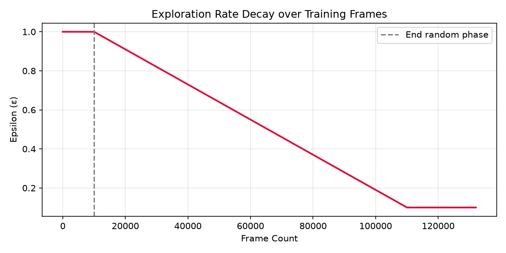
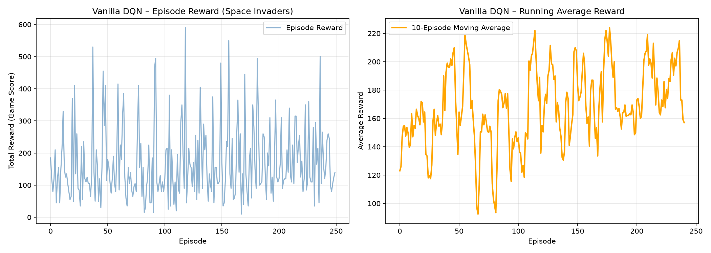
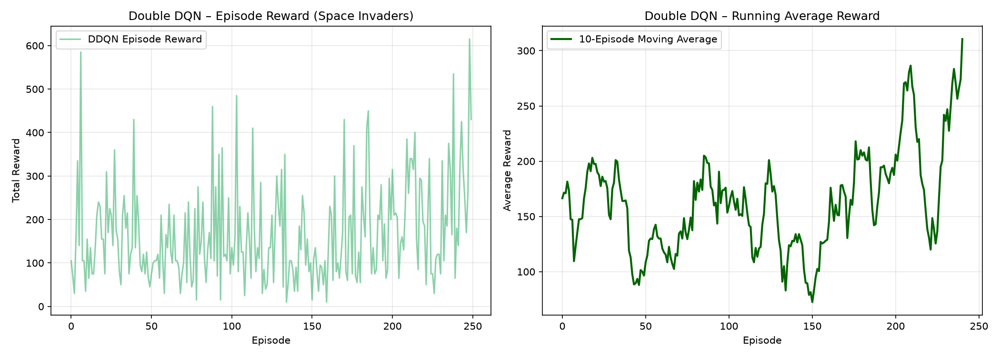
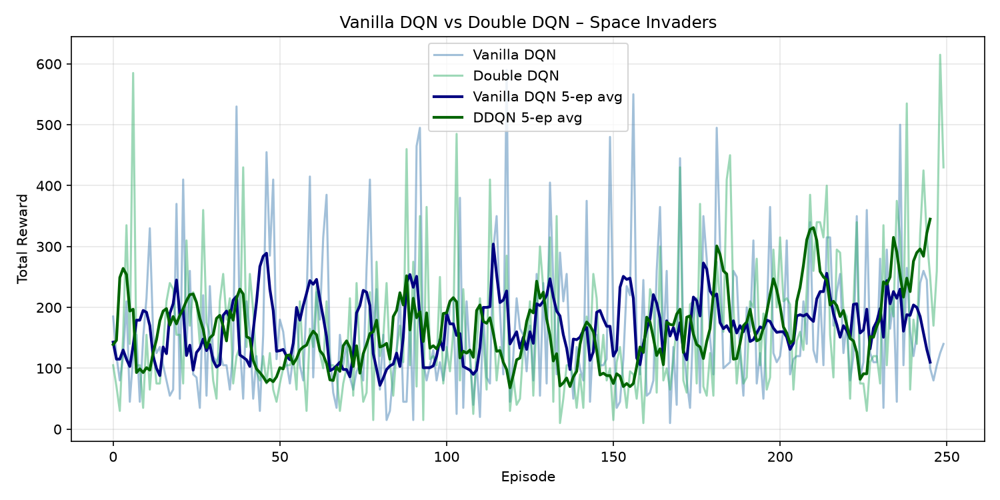
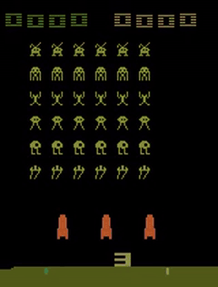

# Deep Q-Learning on Atari Space Invaders: DQN vs Double DQN

CS6482 Deep Reinforcement Learning coursework (Assignment 2): a **Vanilla DQN** and a **Double DQN** agent trained to play **Space Invaders** (`ALE/SpaceInvaders-v5`) from raw pixels, using TensorFlow/Keras and Gymnasium.

## What's in the notebook

[`dqn_ddqn_space_invaders.ipynb`](dqn_ddqn_space_invaders.ipynb) covers:

1. **Why reinforcement learning** suits game playing.
2. **The environment:** observation and action spaces, and the preprocessing pipeline (grayscale, 84×84, frame skip 4, 4-frame stack).
3. **Vanilla DQN:** the Mnih et al. (2015) CNN, experience replay, a target network, ε-greedy exploration, reward clipping and the Huber loss.
4. **Evaluation:** episode reward, moving averages and the ε schedule.
5. **Double DQN extension:** the online network selects the next action and the target network evaluates it, reducing overestimation bias. Includes a side-by-side comparison and a recorded gameplay video of the better agent.
6. **Reflection**, references and a statement of work.

## Results

Both agents were trained for 250 episodes (about 125,000 frames). The ε schedule is below: 10,000 random frames, then a linear decay to 0.1 by 110,000 frames.

<p align="center"></p>

**Vanilla DQN** scores are noisy, with a 10-episode moving average mostly between 120 and 220 and a best episode of about 590.

<p align="center"></p>

**Double DQN** has a similar noisy start but its moving average climbs towards the end of training, reaching about 300, with a best episode of about 615.

<p align="center"></p>

**Side by side:**

<p align="center"></p>

Double DQN ends higher, but this is one run per method with high variance, so the gap is suggestive rather than conclusive. A fair comparison would need several seeds and a longer run.

### Gameplay

A recorded episode of the trained agent (full-quality video: [`results/gameplay.mp4`](results/gameplay.mp4)):

<p align="center"></p>

## Changes since submission

This version was cleaned up after the module was graded:

- The ε schedule now fits the training budget (10,000 random frames, then decay to 0.1 over 100,000 frames). Previously ε decayed over 1,000,000 frames but training stopped near 125,000, so the agents were still acting almost randomly.
- Only a true game over stops bootstrapping in the Bellman target; time-limit truncation no longer counts as terminal.
- Learning starts only after the replay buffer has been filled with random experience.
- `model.predict()` calls inside the training loops were replaced with direct model calls, which removes a large per-step overhead.
- The gameplay recording now uses the same environment settings as training, picks the better of the two agents and comes after the results.
- Removed duplicated cells and imports, and fixed typos.

The plots and video in `results/` come from a run of this fixed version.

## Use the trained agents (no training needed)

The fully trained models are in [`models/`](models/) (`double_dqn.keras` and `vanilla_dqn.keras`, about 7 MB each). To watch one play:

```bash
pip install -r requirements.txt
python play_agent.py                            # Double DQN, records gameplay.mp4
python play_agent.py --model vanilla            # Vanilla DQN
python play_agent.py --episodes 5 --render      # 5 games in a live window, prints the average score
```

`play_agent.py` rebuilds the network and loads only the saved weights, so it works on any Python version.

## Retraining from scratch

```bash
pip install -r requirements.txt
jupyter notebook dqn_ddqn_space_invaders.ipynb
```

Each agent trains for 250 episodes (about 125,000 frames). This takes hours on a CPU, so a GPU is recommended. Lower `MAX_EPISODES` for a quick test.
